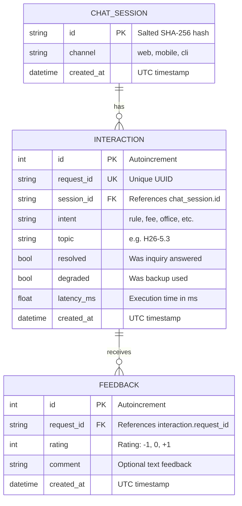

# Lab 5 — Data Model Worksheet

## 1. Critique the Bad Schema (`sql/bad_schema.sql`)

| # | Problem | Why it hurts | Fix |
|---|---|---|---|
| 1 | **No PRIMARY KEY / Constraints on `id`** (`id INTEGER`) | Rows cannot be uniquely or reliably identified; duplicate IDs and `NULL` values are permitted. Lookups and joins cannot use index acceleration. | Define `id INTEGER PRIMARY KEY AUTOINCREMENT` (or use unique `request_id TEXT PRIMARY KEY`). |
| 2 | **Storing sensitive PII** (`student_name`, `student_phone`) | Storing unnecessary personal data violates privacy principles and Vietnam's Personal Data Protection Law. Increases leak and misuse risks. | Remove PII columns entirely. Track conversations anonymously using a salted cryptographic hash (`session_id`). |
| 3 | **Storing full raw messages forever** (`message TEXT`, `answer TEXT`) | User prompts may contain confidential information (passwords, IDs, personal situations). Storing them creates high liability and storage bloat. | Discard raw message and answer bodies. Only store metadata: `intent`, `topic`, `resolved`, `degraded`, and `latency_ms`. |
| 4 | **Unnormalized free-text intent** (`'fee'`, `'Fee'`, `'FEE'`, `'tuition'`) | Inconsistent casing and naming break `GROUP BY` aggregations and reporting, making analytical metrics inaccurate. | Validate and normalize intents at the application level to canonical lowercase strings or enums (`fee`, `rule`, `office`, etc.). |
| 5 | **Timestamp stored as unstandardized text** (`'5/10/2026 9:03 PM'`) | Cannot be sorted chronologically, indexed properly, or queried using standard SQLite date/time functions like `strftime`. | Store as ISO 8601 UTC timestamp (`datetime` / `TIMESTAMP DEFAULT CURRENT_TIMESTAMP`). |
| 6 | **Comma-separated feedback values** (`feedback TEXT` with `'1,-1,1'`) | Violates 1st Normal Form (1NF). Impossible to calculate `AVG(rating)`, filter individual ratings, or link feedback to specific timestamps and comments. | Extract into a separate `feedback` table with a foreign key referencing `interaction(request_id)`. |
| 7 | **Latency stored as text with unit** (`latency TEXT: '120ms'`) | Cannot perform arithmetic operations (`AVG`, `MIN`, `MAX`) or numerical sorting without brittle string parsing. | Store as a numeric type (`latency_ms REAL` or `INTEGER`). |

---

## 2. Store or Not? (Privacy-Aware Storage)

| Data | Store? | Form (raw / hashed / aggregated / none) | Retention | Reason |
|---|---|---|---|---|
| **raw user message** | **No** | None | 0 days (ephemeral in-memory) | May contain private details, credentials, or student IDs; no analytical feature requires raw text. |
| **session id** | **Yes** | Hashed (SHA-256 + secret salt from `.env`) | 90 days | Enables session counting and conversation boundary detection without identifying individual users. |
| **intent, latency, topic** | **Yes** | Structured raw metadata | 180 days | Essential for performance tracking, identifying knowledge gaps, and monitoring bot degradation. |
| **feedback rating** | **Yes** | Integer (-1, 0, 1) | 365 days | Core metric for measuring response quality and student satisfaction over time. |
| **feedback comment** | **Yes** | Sanitized raw text | 90 days | Provides qualitative context to fix inaccurate answers; reviewed and purged periodically. |
| **student name / phone** | **No** | None | 0 days | Completely unnecessary for assistant functionality; strictly prohibited by data minimization principles. |

---

## 3. Product Questions → Fields

| Product Question | Fields Needed | Table(s) | Query Sketch |
|---|---|---|---|
| **Most failed intent?** | `intent`, `resolved` | `interaction` | `SELECT intent, COUNT(*) AS failures FROM interaction WHERE resolved = 0 GROUP BY intent ORDER BY failures DESC;` |
| **Average response time by intent?** | `intent`, `latency_ms` | `interaction` | `SELECT intent, ROUND(AVG(latency_ms), 1) AS avg_ms FROM interaction GROUP BY intent ORDER BY avg_ms DESC;` |
| **Top unresolved topics?** | `topic`, `resolved` | `interaction` | `SELECT topic, COUNT(*) AS count FROM interaction WHERE resolved = 0 AND topic IS NOT NULL GROUP BY topic ORDER BY count DESC LIMIT 5;` |

---

## 4. Entity-Relationship (ER) Diagram

