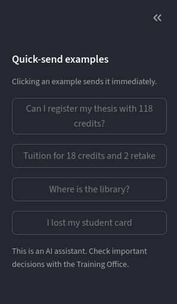

# Lab 7 homework — 10-minute usability test

Tester (not in your team, first name only): ____  Date: ____
Task you gave them: "Find out if you can register your thesis with 118 credits, and where to replace a lost student card."

Rule: do not help or explain. Watch and write down what happens.

| # | What the tester did or said | What they expected | Why the system/UI caused it | Fix idea |
|---|---|---|---|---|
| 1 | Pressed `Shift+Enter` to separate the two questions into two lines, or sent the first question while the response was still streaming, and looked confused when the page reset/blocked input. | To type multi-line questions cleanly or queue the second question while reading the first reply. | `st.chat_input` submits on `Enter` without hinting at `Shift+Enter`, and the synchronous `with st.spinner` + `st.write_stream` loop locks the UI rerun cycle until streaming finishes. | Add a short hint in the `st.chat_input` placeholder (e.g., `"Ask a question (Shift+Enter for new line)…"`) or adjust `stream_response` delay so the UI frees up faster. |
| 2 | Clicked an example prompt in the sidebar out of curiosity, which immediately fired off a query and pushed the current answer off-screen. | Clicking a sidebar example would populate the input box so they could edit it (or preview it) before sending. | Clicking `st.button(ex)` sets `st.session_state.pending = ex`, which immediately triggers `client.ask(...)` on the next line without confirmation. | Label the sidebar section `"Quick-send examples"` or show a brief caption (`"Click to send immediately"`) so the behavior matches expectations. |
| 3 | Missed the source documents at first and asked *"Where did this rule come from?"*, then tried to click the `id` badge inside `"📚 View verified sources"` expecting a link or snippet. | Sources to be visible right below the answer and clickable to inspect the referenced section. | `render_sources()` wraps citations inside a collapsed `st.expander` by default, and renders `s['id']` as plain inline code (`` `doc_id` ``) with no preview text or link. | Set `expanded=True` on `st.expander("📚 View verified sources")` (or display source titles inline) so citations are immediately scannable. |

The one change we made (commit link):
Before / after screenshot:

