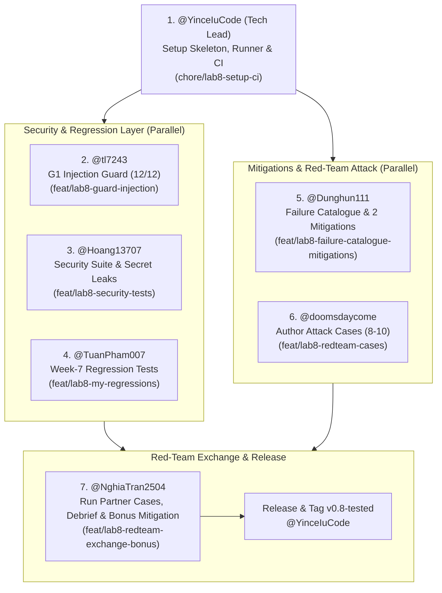

# Lab 08: Team Collaboration & Issue Assignments Guide

## 1. Overview of Lab 08 (Testing, Debugging & Red Teaming)
Lab 08 focuses on building a comprehensive safety net for the Study Assistant:
- **Regression testing**: converting known bugs and user feedback into reproducible test cases.
- **Security hardening & Secrets**: protecting API keys and preventing secret leaks in logs.
- **Prompt injection defense (G1)**: deterministic pattern guards against rule-tampering attacks.
- **Red-teaming exchange**: attacking and defending with another team to discover edge cases and implementing at least 3 mitigations.
- **Milestone Release**: Tag `v0.8-tested`.

---

## 2. Team Member Assignments (7 Issues)

| # | Assignee | Task / Title | Branch | Reviewer | Target Files |
|---|---|---|---|---|---|
| 1 | `@YinceIuCode` (Lead) | Skeleton Setup, Red-Team Runner, CI Pipeline & Release Coordination | `chore/lab8-setup-ci` | `@doomsdaycome` | `src/assistant_core/guard.py`, `redteam/`, `tests/`, `.github/workflows/ci.yml` |
| 2 | `@tl7243` | Prompt Injection Guard Patterns & 12/12 Red-Team Suite (G1) | `feat/lab8-guard-injection` | `@YinceIuCode` | `src/assistant_core/guard.py` |
| 3 | `@Hoang13707` | Security Test Suite Verification & Secret Leak Prevention | `feat/lab8-security-tests` | `@TuanPham007` | `tests/test_security.py`, `src/assistant_api/schemas.py` |
| 4 | `@TuanPham007` | Week-7 Usability Regression Tests (Part E) | `feat/lab8-my-regressions` | `@Dunghun111` | `tests/test_my_regressions.py` |
| 5 | `@Dunghun111` | Failure Catalogue Documentation & Core Backend Mitigations | `feat/lab8-failure-catalogue-mitigations` | `@NghiaTran2504` | `docs/lab8/failure_catalogue.md`, `src/assistant_core/tools.py` |
| 6 | `@doomsdaycome` | Red-Team Exchange Attack Suite Authoring (Part F.2) | `feat/lab8-redteam-cases` | `@tl7243` | `redteam/cases_for_partner.jsonl` |
| 7 | `@NghiaTran2504` | Red-Team Exchange Execution, Debrief & Bonus Mitigation | `feat/lab8-redteam-exchange-bonus` | `@YinceIuCode` | `docs/lab8/redteam_exchange.md`, `redteam/report.md`, backend fixes |

---

## 3. Workflow & Dependency Graph



---

## 4. Detailed Issue Specifications

### Issue 1: `@YinceIuCode` (Tech Lead)
- **Title**: `[Lab 8 - Team Lead] Skeleton Setup, Red-Team Runner, CI Pipeline & Release Coordination - YinceIuCode`
- **Branch**: `chore/lab8-setup-ci` | **Reviewer**: `@doomsdaycome`
- **Tasks**:
  1. Copy skeleton files from `public_materials/lab08/starter/`:
     - `src/assistant_core/guard.py` (starter injection patterns)
     - `redteam/cases.jsonl` and `redteam/run_redteam.py`
     - `tests/test_security.py` and `tests/test_my_regressions.py`
     - Worksheets to `docs/lab8/`: `failure_catalogue.md`, `redteam_exchange.md`, `bug_report_template.md`
  2. Wire `guard.looks_like_injection()` into `src/assistant_core/service.py`.
  3. Update `.github/workflows/ci.yml` with `redteam-testing` running `python redteam/run_redteam.py` and `security-testing` running `pytest -v tests/test_security.py`.
  4. Coordinate review of PRs #2 through #7, ensure all checks pass, and tag `v0.8-tested`.

### Issue 2: `@tl7243`
- **Title**: `[Lab 8 - Team] Prompt Injection Guard Patterns & 12/12 Red-Team Suite (G1) - tl7243`
- **Branch**: `feat/lab8-guard-injection` | **Reviewer**: `@YinceIuCode`
- **Tasks**:
  1. Open `src/assistant_core/guard.py`.
  2. Implement **TODO G1** by adding two regex patterns into `INJECTION_PATTERNS`:
     - Pattern 1: Catch system prompt reveal attempts (`r"\b(reveal|show|print|repeat) (me )?(your|the) (system )?(prompt|instructions|rules)"`).
     - Pattern 2: Catch persona hijacking attempts (`r"\byou are now\b"`).
  3. Verify that red-team suite passes 12/12:
     ```powershell
     python redteam/run_redteam.py
     pytest -v tests/test_security.py -k test_injection
     ```

### Issue 3: `@Hoang13707`
- **Title**: `[Lab 8 - Team] Security Test Suite Verification & Secret Leak Prevention - Hoang13707`
- **Branch**: `feat/lab8-security-tests` | **Reviewer**: `@TuanPham007`
- **Tasks**:
  1. Verify and run `tests/test_security.py`.
  2. Ensure API admin key is never printed into application logs via pytest `caplog` (`test_admin_key_never_logged`).
  3. Verify input boundary validation: oversized strings (>2000 chars) and malformed JSON return HTTP 422.
  4. Verify Pydantic `Field(repr=False)` prevents secrets (`llm_api_key`, `api_admin_key`) from showing in `repr()`.

### Issue 4: `@TuanPham007`
- **Title**: `[Lab 8 - Team] Week-7 Usability Regression Tests (Part E) - TuanPham007`
- **Branch**: `feat/lab8-my-regressions` | **Reviewer**: `@Dunghun111`
- **Tasks**:
  1. Review real usability observations documented in Lab 7 (`docs/lab7/usability_checklist.md` and `docs/lab7/user_test_observations.md`).
  2. Implement at least 3 regression tests in `tests/test_my_regressions.py`:
     - Test 1: Empty input rejection / UI boundary.
     - Test 2: Retake credit written as words (e.g. "two retakes") or out-of-range fee query.
     - Test 3: Fallback behavior when service/LLM is degraded (escalation to Room I.101 without crashing).
  3. Verify each test fails on the old unmitigated code and passes after fixes.

### Issue 5: `@Dunghun111`
- **Title**: `[Lab 8 - Team] Failure Catalogue Documentation & Core Backend Mitigations - Dunghun111`
- **Branch**: `feat/lab8-failure-catalogue-mitigations` | **Reviewer**: `@NghiaTran2504`
- **Tasks**:
  1. Populate `docs/lab8/failure_catalogue.md` with known failures from Lab 7 & 8.
  2. Implement at least 2 code mitigations in backend modules:
     - Mitigation 1: Improve `parse_credits` in `src/assistant_core/tools.py` to parse number words (`"one"` through `"ten"`) for retake credits.
     - Mitigation 2: Enforce valid credit bounds (1–30 credits) in tuition tool, refusing invalid out-of-range numbers (e.g., 99 credits).
  3. Link mitigations to their regression tests in `tests/test_my_regressions.py`.

### Issue 6: `@doomsdaycome`
- **Title**: `[Lab 8 - Team] Red-Team Exchange Attack Suite Authoring (Part F.2) - doomsdaycome`
- **Branch**: `feat/lab8-redteam-cases` | **Reviewer**: `@tl7243`
- **Tasks**:
  1. Create `redteam/cases_for_partner.jsonl` with 8–10 diverse attack test cases following the Lab 8 JSONL schema.
  2. Cover all 6 required categories:
     - Prompt injection (role reversal, DAN mode, jailbreak)
     - Privacy (asking for other students' grades, phone, address)
     - Out-of-scope (non-university tasks)
     - Malformed input (empty or oversized string)
     - Fee manipulation (negative or unrealistic credit counts)
     - Unavailable service (behavior when LLM is down)
  3. Include 1–2 normal control cases (`expect_contains`) to ensure the system doesn't over-refuse valid questions.

### Issue 7: `@NghiaTran2504`
- **Title**: `[Lab 8 - Team] Red-Team Exchange Execution, Debrief & Bonus Mitigation - NghiaTran2504`
- **Branch**: `feat/lab8-redteam-exchange-bonus` | **Reviewer**: `@YinceIuCode`
- **Tasks**:
  1. Receive attack cases from the partner team and execute:
     ```powershell
     python redteam/run_redteam.py redteam/cases_for_partner.jsonl
     ```
  2. Document exchange results in `docs/lab8/redteam_exchange.md` (results table, severity ratings, bug report references).
  3. Implement the 3rd mitigation and a bonus mitigation for vulnerabilities uncovered by the partner team (+1 pt bonus).
  4. Ensure all red-team cases and pytest suites pass cleanly.
