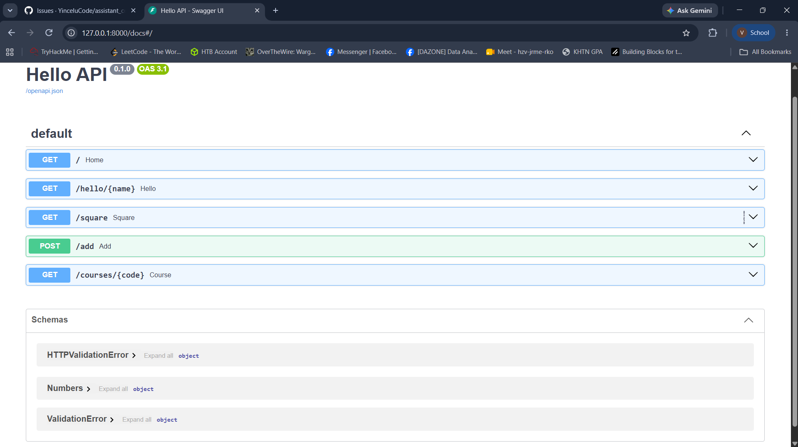

# Personal Reflection (H2) & Lab 4 Deliverables

- **Student / GitHub:** `@YinceIuCode`
- **Course:** CSC10014 - Computational Thinking
- **Week:** Week 4 (REST API Backend)

---

## Reflection H2: Difference between `service.handle()` (Lab 3) and `POST /v1/chat` (Lab 4)

1. **Invocation Scope & Transport:** `service.handle()` operates strictly in-memory as an internal Python method call within a single runtime process, whereas `POST /v1/chat` exposes a networked RESTful endpoint over HTTP, enabling external clients (web browsers, mobile applications, or third-party services) to communicate across network boundaries.
2. **Data Serialization & Validation:** `service.handle()` expects pre-constructed Python/Pydantic domain objects (`Message` returning `Response`), whereas `POST /v1/chat` consumes raw JSON payloads across the wire, automatically validates and maps them via request schemas (`ChatRequest` / `ChatResponse`), and enriches the response with transport-level metadata such as a unique `request_id`.
3. **Error Handling & HTTP Semantics:** In case of failure or malformed input, `service.handle()` returns internal degradation flags (`degraded=True`) or raises domain exceptions. In contrast, `POST /v1/chat` translates those situations into standardized HTTP status codes (e.g., `422 Unprocessable Entity` for validation errors, `500 Internal Server Error` for upstream faults) with consistent JSON error envelopes.
4. **Cross-Cutting Web Concerns:** `POST /v1/chat` acts as a protective boundary integrating web-layer concerns such as per-client IP rate limiting (`RateLimiter` returning `429 Too Many Requests`), connection timeouts, and headers inspection, none of which belong to or are known by the core domain logic in `service.handle()`.
5. **Decoupling & Interoperability:** `POST /v1/chat` achieves complete language-agnostic interoperability, allowing any frontend technology stack to integrate with the assistant without being coupled directly to the underlying Python implementation details of `service.handle()`.

---

## Verification Evidence: Swagger UI (`/docs`)

Execution of `POST /v1/chat` tested successfully via Swagger UI with response `200 OK`:

